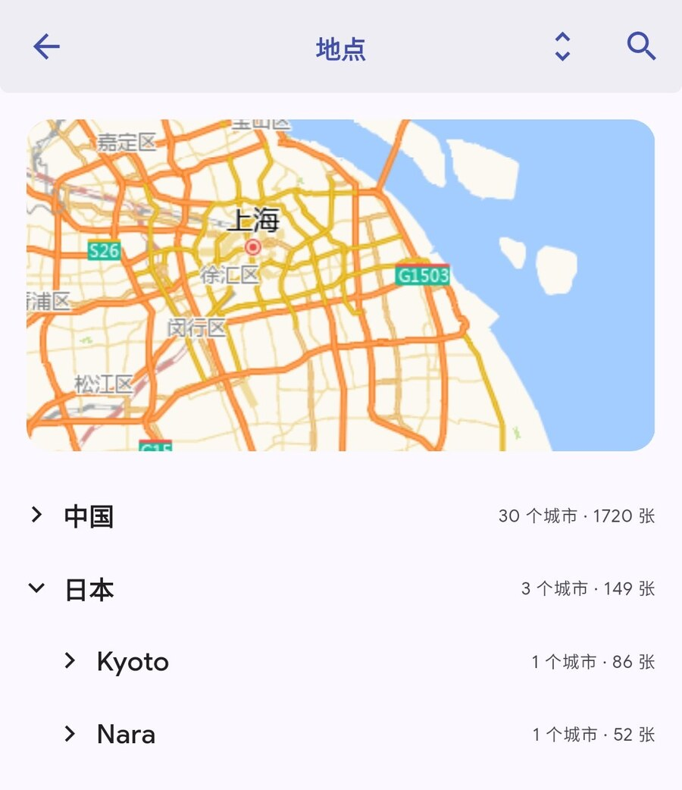

# Immich 自用工具链（总项目）

个人使用的 Immich 相关项目索引。**不是 Immich 官方项目**，与
[immich-app/immich](https://github.com/immich-app/immich) 没有隶属关系。

## 三个项目

| 仓库 | 作用 | 形态 |
| --- | --- | --- |
| [whxciotw/immich-app](https://github.com/whxciotw/immich-app) | 非官方 Android 构建：修复 Places 地图初始位置，地点页国家/省/市三级折叠，App 内更新 | GitHub fork（AGPL-3.0） |
| [whxciotw/immich-amap](https://github.com/whxciotw/immich-amap) | 高德底图样式、GCJ-02 纠偏代理、中文地名库、通用 Docker 部署 | 独立仓库（MIT） |
| **本仓库** `immich` | 门户：项目关系、版本兼容、部署顺序、发布索引 | 文档 |

## 它们怎么配合

```
                    ┌────────────────────────────┐
照片/视频 ─────────► │  Immich Server（官方镜像）  │
                    └────────────┬───────────────┘
                                 │ 地图样式 URL
                    ┌────────────▼───────────────┐
                    │  immich-amap               │
                    │  tile-proxy（GCJ-02 纠偏） │
                    │  mapstyle（nginx 样式托管）│
                    │  中文 geodata（挂载）      │
                    └────────────┬───────────────┘
                                 │ 浏览器 / 手机 App 直接取瓦片与样式
                    ┌────────────▼───────────────┐
                    │  Immich Web / 手机客户端    │
                    │  可选：immich-app（DIY APK）│
                    └────────────────────────────┘
```

- `immich-amap` 解决"底图 + 纠偏 + 中文地名"；
- `immich-app` 解决手机端 Places 地图初始位置写死夏威夷 / `(0,0)` 的问题，
  并附带地点页三级折叠和 App 内更新；
- 两者互相独立，只用官方 Web 端也可以只部署 `immich-amap`。

## 截图

<p align="center">
  
</p>

<p align="center"><em>immich-app：地点页按国家 → 省 → 市折叠展示。</em></p>

## 部署顺序（推荐）

1. 按 [immich-amap README](https://github.com/whxciotw/immich-amap#readme) 部署
   `tile-proxy` + `mapstyle`，生成样式 URL；
2. 在 Immich → 管理 → 系统设置 → 地图与 GPS 设置 填入亮色/暗色样式 URL；
3. 如需手机端地图初始位置修复：从
   [immich-app Releases](https://github.com/whxciotw/immich-app/releases/latest)
   下载 APK（包名 `app.alextran.immich.yunshang`，可与官方 App 共存）。

## 版本兼容

| 组件 | 版本 |
| --- | --- |
| Immich Server | v3.x（官方镜像，本项目未修改服务端） |
| immich-app | 基于上游 `v3.3.6`，随上游 stable 自动同步（tag `vX.Y.Z-yunshang.N`） |
| immich-amap | v3.3.x 实测；样式是标准 MapLibre style v8，版本兼容性较宽 |

## 发布与更新

- APK：`immich-app` 的 [Releases](https://github.com/whxciotw/immich-app/releases)；
- 地图工具：`immich-amap` 的 `main` 分支与 [CHANGELOG](https://github.com/whxciotw/immich-amap/blob/main/CHANGELOG.md)；
- 上游 Immich 发新 stable 后，`immich-app` 会自动构建新 APK（如 GitHub 定时任务未触发，
  到 Actions 页手动运行）。

## 许可

- `immich-app`：上游 AGPL-3.0（fork 保持公开）；
- `immich-amap`：MIT；
- 本仓库文档：MIT。
- 非官方项目，请勿当作 Immich 官方版本传播。
